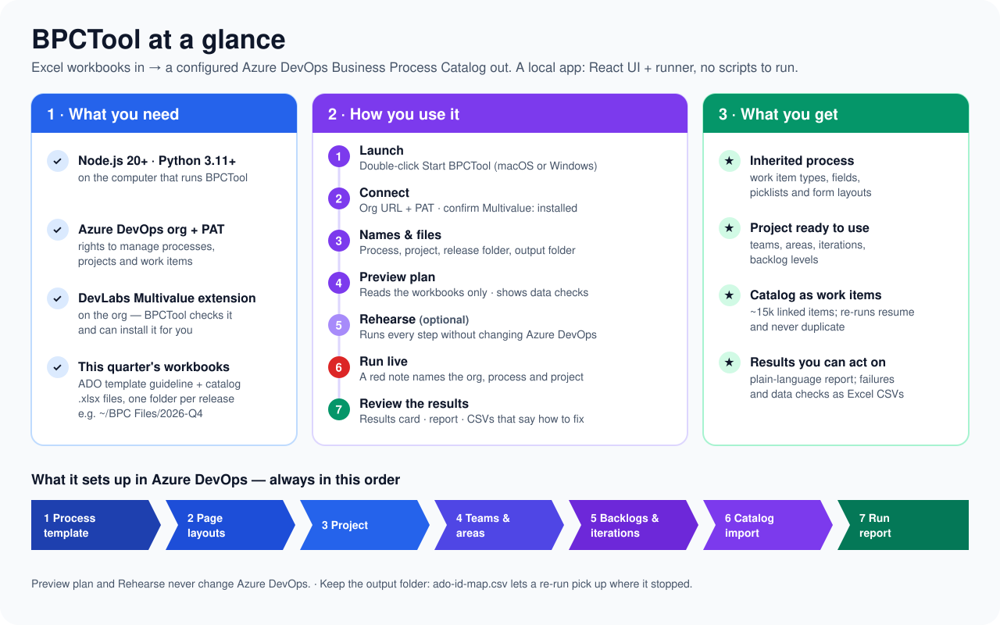
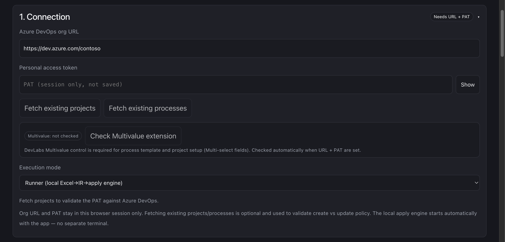
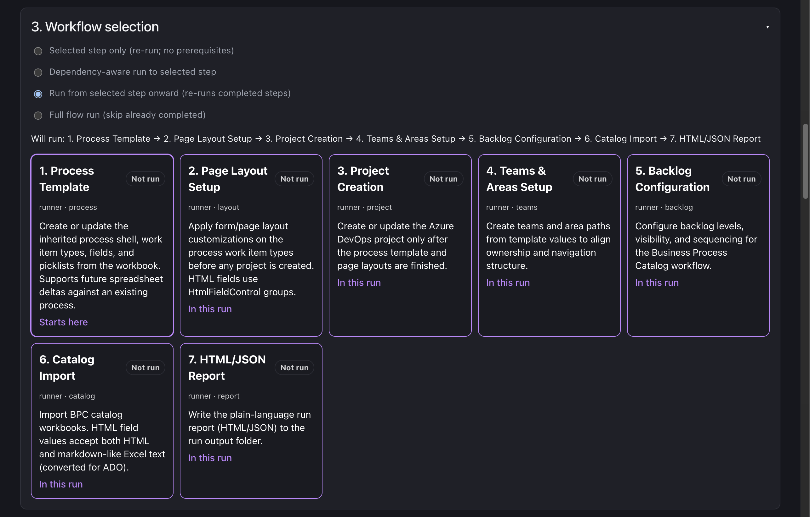
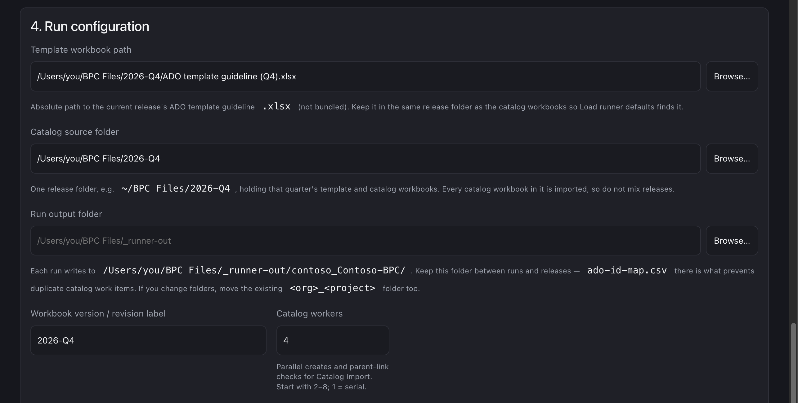
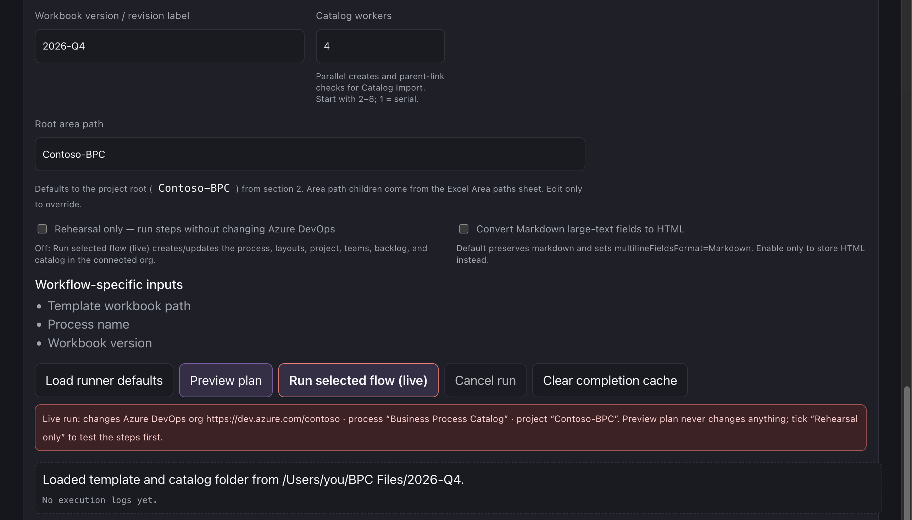
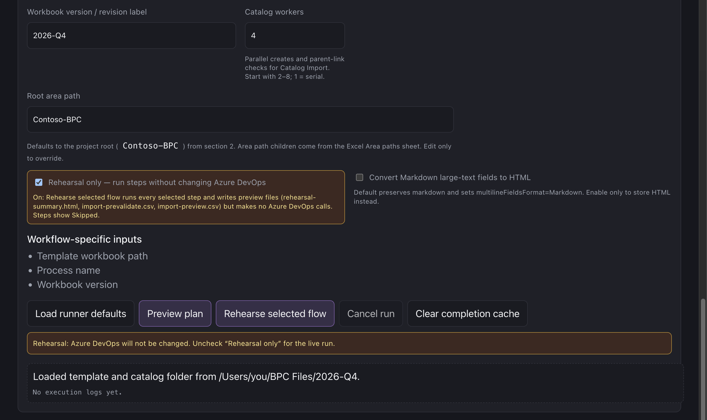
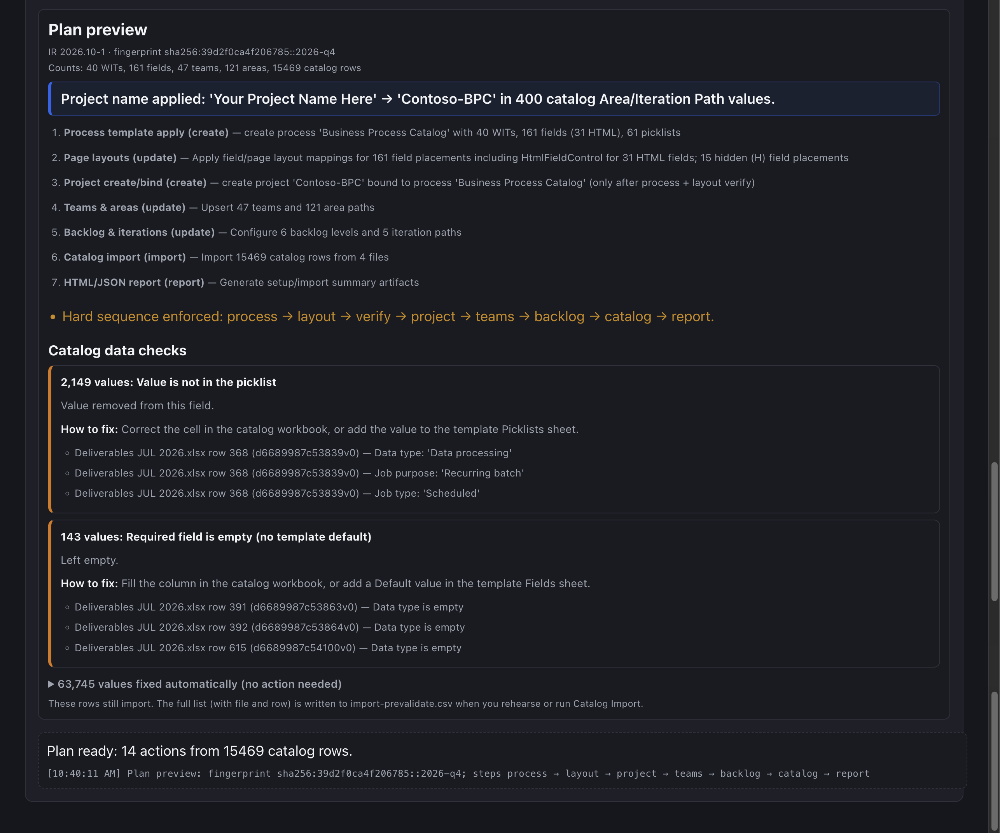
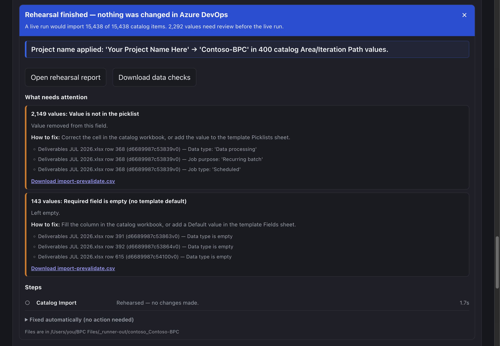

# BPCTool - Simplifying Setup of Business Process Catalog Based ADO  Projects

**BPCTool** simplifies the deployment of Microsoft's [Business Process Catalog (BPC)](https://learn.microsoft.com/dynamics365/guidance/business-processes/about-import-catalog-devops) to Azure DevOps. Using Microsoft's quarterly BPC Excel workbooks, it automatically configures the required Azure DevOps process and project structure, including page layouts, teams, areas, backlog levels, and iterations, and then imports catalog content such as Deliverables and Objectives as linked work items.

BPCTool runs as a standalone application with a browser-based interface. Excel remains the source format, while BPCTool handles the deployment workflow: **read the workbooks, preview the planned changes, and apply them through the Azure DevOps REST APIs.**
Because BPCTool is release-independent, it can be used with the latest Microsoft BPC workbooks as they become available.



- [Requirements](#requirements)
- [Install and launch](#install-and-launch)
- [Using BPCTool](#using-bpctool)
- [Screenshots](#screenshots)
- [Folder layout](#folder-layout)
- [Workflow steps](#workflow-steps)
- [Modes](#modes)
- [Results and output files](#results-and-output-files)
- [How workbook data is handled](#how-workbook-data-is-handled)
- [Documentation](#documentation)
- [For developers](#for-developers)
- [License](#license)


## Requirements

- **Node.js 20.19+ or 22.12+** (Vite 8) and **Python 3.11+** on the machine that runs BPCTool.
- An Azure DevOps organization and a **PAT**. Full setup needs Work Items *Read, write, & manage*, Project and Team *Read, write, & manage* and Extensions *Read*; a catalog-only import or a rehearsal needs less — see [PAT scopes](./bpctool/USER_GUIDE.md#pat-scopes).
- The [Multivalue control (Microsoft DevLabs)](https://marketplace.visualstudio.com/items?itemName=ms-devlabs.vsts-extensions-multivalue-control) extension on the org — required for Multi-select fields and for the process / layout / project steps. The Connection panel checks for it and can install it when the PAT allows; otherwise an org admin installs it.
- The current release's **ADO template guideline** `.xlsx` and catalog workbooks. They are **not** bundled.


## Install and launch

The app lives in [`bpctool/`](./bpctool/).

- **macOS:** double-click `bpctool/Start BPCTool.command`
- **Windows:** double-click `bpctool/Start BPCTool.bat`

The first launch installs the npm and Python dependencies, then starts the UI and the local runner and opens your browser. Leave that window open while you work; close it to stop BPCTool.

From a terminal instead:

```bash
cd bpctool
npm run setup   # once: node_modules + .venv (npm start also creates .venv if missing)
npm start       # UI + auto-started runner (opens the browser)
```


## Using BPCTool

1. **Connection** — enter the org URL (`https://dev.azure.com/{org}`, `{org}.visualstudio.com`, or just the org name) and PAT (kept in the browser tab's session storage, cleared when the tab closes). Existing projects and processes load automatically. Confirm **Multivalue: installed**, or use **Check** / **Install**.
2. **Execution mode** — **Runner** (default).
3. **Process & project names** — enter names, an optional project description, and the update policy.
4. **Workflow selection** — pick a run mode and a step card (see [Modes](#modes)).
5. **Run configuration** — confirm the pre-filled **Template workbook path**, **Catalog source folder** (one release folder), and **Workbook version**; use **Browse…** or **Load runner defaults** to change them. Optionally choose a **Run output folder**.
6. **Preview plan** — reads the workbooks and shows the steps, counts, warnings, and catalog data checks. It never contacts Azure DevOps.
7. Optional: tick **Rehearsal only** → **Rehearse selected flow** runs every selected step and writes the preview files, still without changing Azure DevOps. If the project already exists, it also reports which existing work items differ from the workbook.
8. Untick **Rehearsal only** → **Run selected flow (live)**. The red note under the buttons names the org, process, and project that will change.
9. When the run finishes, the **results card** shows the headline, what needs attention, and buttons to open the report and download the CSVs.

Defaults:

- Folder root `~/BPC Files` (`BPCTOOL_CATALOG` to change); the newest release subfolder is selected.
- Template: newest `ADO template guideline*.xlsx` in the release folder (or Browse… / `BPCTOOL_TEMPLATE`).
- Workbook version: the release folder name (e.g. `2026-Q4`). A label only — it is never sent to Azure DevOps. It appears in the plan and report fingerprint, and a new label tells the UI a new spreadsheet is being applied to an existing process ([USER_GUIDE §10](./bpctool/USER_GUIDE.md#10-spreadsheet-deltas--fingerprints)).
- Root area path: the project name. Set a path below the project (e.g. `Contoso-BPC\BPC`) to nest the template areas and catalog Area Paths under it.
- `Your Project Name Here` in any workbook area or iteration path is replaced with the project name from the form, and reported in the results.
- Run output folder: `BPCTOOL_OUTPUT_DIR`, else `bpctool/runner-out/`.

Step-by-step detail, every option, and troubleshooting: [USER_GUIDE](./bpctool/USER_GUIDE.md).

## Screenshots

Sample UI in Runner mode (dark theme). Paths and names are illustrative.

**Connection** — org URL, PAT (kept for this browser tab only), Multivalue check



**Workflow selection** — four run modes and seven step cards. Here **Run from selected step onward** starts at Process Template, and every card in the run is marked.



**Run configuration** — template workbook, catalog release folder, and the run output folder (the `<org>_<project>` subfolder is shown under it, with the `-<code>` name used when another project's results already have that name)



**Live run** — the button reads **Run selected flow (live)** and a red note names what will change



**Rehearsal** — with **Rehearsal only** ticked, an amber note confirms Azure DevOps will not be changed ([Preview plan vs Rehearsal only vs live run](./bpctool/USER_GUIDE.md#preview-plan-vs-rehearsal-only-vs-live-run))



**Preview plan** — steps and counts, the highlighted project-name substitution, and the catalog data checks with example rows and how to fix them



**Results card** — shown when a run finishes: headline, what needs attention, links to the report and CSVs, and (for a rehearsal against an existing project) the changes since the last import



## Folder layout

Keep each quarterly release in its own folder, template and catalog workbooks together:

```text
~/BPC Files/
  2026-Q4/
    ADO template guideline (…).xlsx
    Business Process Catalog ….xlsx · Deliverables ….xlsx · Objectives ….xlsx · SbD Delivery Plan ….xlsx
  2026-Q3/ …
  _archive/            "_" or "." prefix → ignored
```

Every catalog workbook in the selected folder is imported, so don't mix releases. Run outputs go to `<Run output folder>/<org>_<project>/` — keep that folder between runs and releases: its `ado-id-map.csv` is what stops a re-run from creating duplicate catalog items. Folder settings can also live in `bpctool/bpctool.env` (copy `bpctool.env.example`). Details: [USER_GUIDE §2 Folder layout](./bpctool/USER_GUIDE.md#folder-layout-recommended).

## Workflow steps

1. **Process template** — work item types, fields, picklists (Multi-select → suggested lists); disables types the workbook disables (e.g. Epic / Feature / User story)
2. **Page layouts** — before any project; DevLabs Multivalue control for Multi-select fields
3. **Project** — create or bind, with an optional description; an existing project must use the selected process
4. **Teams & areas** — multi-path team assignments (with *Include sub areas* from the Teams sheet), optionally under a root area below the project
5. **Backlog & iterations** — levels from the **Backlogs** sheet, WIT mapping, team iterations (teams in parallel)
6. **Catalog import** — every matching workbook in the catalog folder; parallel, resumable, with parent-link backfill
7. **Report** — HTML/JSON summary


## Modes

**Run modes** (Workflow selection):


| Mode                              | Runs                                                                      |
| --------------------------------- | ------------------------------------------------------------------------- |
| **Selected step only** (default)  | The selected card alone, even if already completed; no prerequisite check |
| **Dependency-aware**              | The selected card plus incomplete steps before it                         |
| **Run from selected step onward** | The selected card and every later card, including completed ones          |
| **Full**                          | All incomplete steps in order                                             |


Project and later steps wait until Process Template and Page Layout have completed (except in Selected step only).

**Preview plan / Rehearsal only / live:** Preview plan only reads the workbooks. Rehearsal only runs the selected steps and writes preview files without changing Azure DevOps; its Catalog Import step only reads, to compare the workbook with an existing project. A live run applies the changes; it checks Azure DevOps itself for an existing process or project before applying the update policy, and only one rehearsal or live run per org + project can run at a time. Comparison: [USER_GUIDE §5](./bpctool/USER_GUIDE.md#preview-plan-vs-rehearsal-only-vs-live-run).

**Execution modes:** **Runner** (default) is the full engine. **API** does live Azure DevOps reads only; **Simulate** uses local stubs for UI testing.

## Results and output files

Each run ends with a **results card** in the UI: a headline, a highlighted line for anything substituted (such as the project name), **What needs attention** with example rows and how to fix them, the steps, and buttons for the files. Files are written to `<Run output folder>/<org>_<project>/`:


| File                         | What it is                                                                                                                           |
| ---------------------------- | ------------------------------------------------------------------------------------------------------------------------------------ |
| `bpc-ado-setup-summary.html` | Plain-language run report, rewritten after every live run (`rehearsal-summary.html` for Rehearsal only)                              |
| `import-failures.csv`        | Rows that failed, for Excel: **Fix this row** vs **Blocked by parent**, the problem, how to fix it, source file and row, value tried |
| `import-prevalidate.csv`     | Every catalog value changed or removed before import (automatic fix vs needs review)                                                 |
| `ado-id-map.csv`             | Catalog key → work item ID. Re-runs resume from it — keep it                                                                         |
| `backfill-links-report.csv`  | Parent-link backfill statuses                                                                                                        |
| `import-preview.csv`         | Sample of the catalog rows as they will be sent                                                                                      |
| `import-changes.csv`         | Rehearsal against an existing project: every difference between the workbook and the work items already there, and rows a live run would duplicate |
| `skipped-deprecated-deleted.csv` | Catalog rows not imported because their Catalog status (or a parent row's) is Deprecated or Deleted |
| `bpctool-target.json`        | The organization and project this folder belongs to. Another project whose name gives the same folder name gets its own `<org>_<project>-<8 characters>` folder |


CSV reports show text starting with `=`, `+`, `-` or `@` with a leading `'` so Excel can't run it as a formula. Reports contain catalog content and work item IDs: keep them with the workbooks, don't post them publicly, and delete folders you no longer need (keep `ado-id-map.csv` while the project may be re-imported).

JSON versions (`*-summary.json`, `import-failures.json`, `import-prevalidate.json`, `import-changes.json`) carry the same data and a shared run ID. Catalog import is create-only for fields; a re-run skips items already in `ado-id-map.csv`, and a rehearsal lists the existing items whose values differ. More: [USER_GUIDE §11 Outputs](./bpctool/USER_GUIDE.md#11-outputs-and-artifacts).

## How workbook data is handled

- **Backlogs** sheet: renames/creates backlog levels, sets default work item types, assigns enabled types from **Work item types**. Disabled types stay disabled in Azure DevOps.
- **Multi-select** fields (Application family, Products, Industries, …) use suggested picklists plus the Multivalue control, so values like `A; B` import. Only fields with **Multi-select field = Yes** in the template Fields sheet get this; `A; B` in any other picklist field (e.g. **Module** in the July template) is removed and reported with that fix.
- **Catalog hierarchy** follows the **Title 1..N** columns (the ADO CSV outline), not Process sequence ID. Rows are tracked by Process sequence ID; a row that repeats an earlier row's ID is still imported with that ID, and tracked in `ado-id-map.csv` as `<id>#<Microsoft ID>`.
- **Deprecated / Deleted rows** (Catalog status) and the rows below them are skipped by default, as the Microsoft importer does — 700 rows in the July workbooks. Tick **Import Deprecated / Deleted rows** in Run configuration to import them.
- **Data checks** before every catalog import (and in Preview plan): project name fixes for Area / Iteration Path, area paths / States / picklist values Azure DevOps would reject are removed, text over 255 characters is shortened, Fields-sheet defaults are applied, picklist casing is aligned. Each change is listed in `import-prevalidate.csv`.
- **Rich text:** HTML from Excel is kept; Markdown is kept by default (sent with `multilineFieldsFormat=Markdown`) or converted with **Convert Markdown large-text fields to HTML**. An empty Description is omitted. Details: [USER_GUIDE §8](./bpctool/USER_GUIDE.md#8-rich-text-html-vs-markdown).
- **Long runs:** catalog progress bar with ETA, **Cancel run** stops cleanly, and reloading the page reattaches to a running job.


## Documentation


| Doc                                                                                        | Purpose                                                                                                                                                         |
| ------------------------------------------------------------------------------------------ | --------------------------------------------------------------------------------------------------------------------------------------------------------------- |
| [Quick reference](./bpctool/docs/QUICK_REFERENCE.md)                                       | One page: start, PAT scopes, run order, which button changes what, run modes, results files, common problems, developer commands                                |
| [USER_GUIDE](./bpctool/USER_GUIDE.md)                                                      | Full usage: install, every screen and option, Excel sheets, outputs, local API, troubleshooting                                                                 |
| [CHANGELOG](./bpctool/CHANGELOG.md)                                                        | Release history                                                                                                                                                 |
| [Workflow & reference-script comparison](./bpctool/docs/workflow-and-script-comparison.md) | Engine steps, quarterly releases, X vs H field applicability, catalog parallel/resume/backfill, incremental re-runs, Microsoft reference scripts vs BPCTool     |


## For developers

```text
bpctool/
  src/                  React UI (Vite)
  runner/               FastAPI runner: Excel → IR → plan → apply
  scripts/              Launcher env + Vite local-runner plugin
  docs/                 Quick reference, comparison doc, screenshots
  Start BPCTool.*       One-click launchers
  bpctool.env.example   Optional folder settings (copy to bpctool.env)
  runner-out/           Default run outputs (gitignored)
```

```bash
cd bpctool
npm start                            # UI + runner (relaunch to load code changes)
npm run dev                          # same, runner with --reload (a code change restarts it mid-run)
npm run runner                       # runner API only (127.0.0.1:8787)
npm test                             # UI tests (vitest)
npm run runner:install-dev           # once: pytest into .venv
npm run runner:test                  # runner tests
npm run lint && npm run build
```

These commands work the same in Terminal, PowerShell and Command Prompt: the `runner*` scripts use `.venv/bin` on macOS / Linux and `.venv\Scripts` on Windows.

The runner listens on `127.0.0.1:8787` and the UI proxies it as `/api/*`: `GET /health`, `GET /defaults`, `POST /plan/dry-run`, `POST /ir/parse`, `POST /jobs`, `GET /jobs/{id}?since=N`, `POST /jobs/{id}/cancel`, `GET /outputs/{folder}/{file}`. It accepts only `Host: 127.0.0.1` / `localhost` and sends no CORS headers. Request fields and curl examples: [USER_GUIDE §12](./bpctool/USER_GUIDE.md#12-local-runner-api).

## License

[CC0 1.0 Universal](./LICENSE) — dedicated to the public domain.